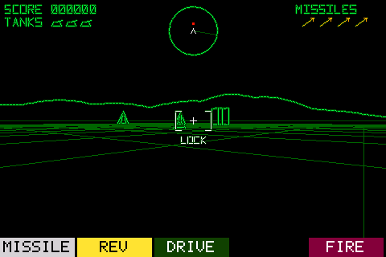
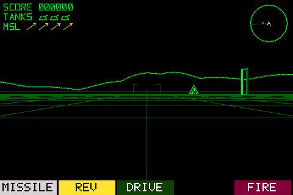
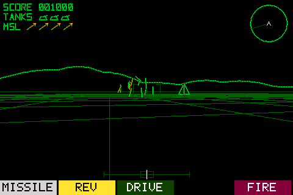
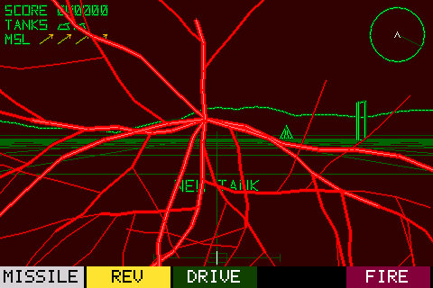
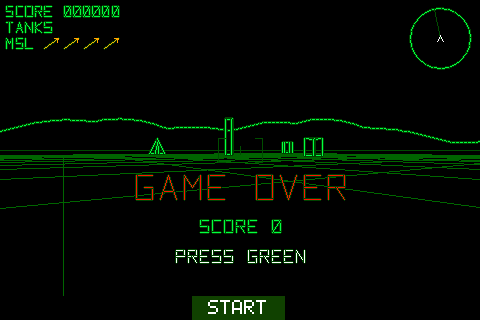
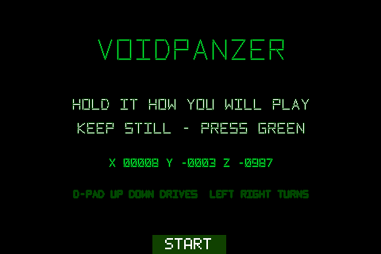
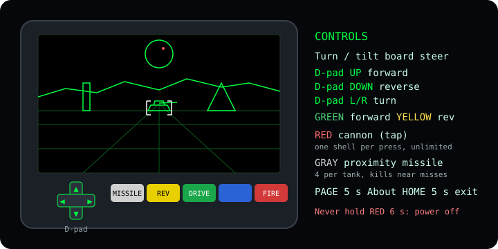
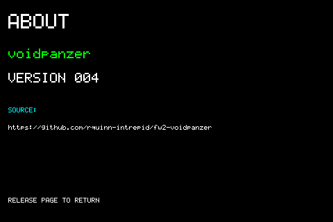

# VoidPanzer

**A first-person wireframe tank battle for the FreeWili 2.**
Neon-green vector lines on black, mountains on the horizon, monoliths and
pyramids to hide behind, and enemy tanks that hunt you down. Steer by turning
the board, drive with the D-pad, hit them with the cannon, and when they get
close, let a proximity missile do the rest.

<p align="center">
  
</p>

---

## Screenshots

<table>
  <tr>
    <td align="center"><br><sub>Score, tanks and missiles top left, radar top right</sub></td>
    <td align="center"><br><sub>Direct hit: the enemy tank breaks into wireframe shards</sub></td>
  </tr>
  <tr>
    <td align="center"><br><sub>You've been hit: the screen cracks and flashes red twice</sub></td>
    <td align="center"><br><sub>Game over</sub></td>
  </tr>
  <tr>
    <td align="center" colspan="2"><br><sub>Setup: hold it how you will play</sub></td>
  </tr>
</table>

## Controls

<p align="center"></p>

| Input | Action |
| --- | --- |
| **Turn or tilt** the board left / right | Steer the tank. Full turn at 40°; the first 15% (6°) does nothing, so a steady hand drives straight. The gauge above the buttons shows where your steering sits |
| **D-pad UP / DOWN** | Drive forward / reverse |
| **D-pad LEFT / RIGHT** | Turn |
| D-pad centre | Re-centre the steering |
| Hold **GREEN** / **YELLOW** | Drive forward / reverse (same as D-pad up / down) |
| Press **RED** | Main cannon: one shell per press, unlimited ammo, 0.5 s reload |
| Press **GRAY** | Proximity missile: 4 per tank |
| Hold **PAGE** 5 s | About screen (game pauses) |
| Hold **HOME** 5 s | Back to the FreeWili menu |

> **Tap red, don't hold it.** Holding red for 6 seconds powers the FreeWili 2
> off. Holding it does not auto-fire anyway, and after 3 s the screen tells you
> to `RELEASE RED`.

## How to play

1. Open **voidpanzer** from the board's App Explorer.
2. **Setup.** Hold the board the way you will play, keep still, press GREEN.
   Then turn or tilt it right, hold it, press GREEN. The game learns whether
   you steer by *turning* (gyro) or *tilting* (accelerometer).
3. **Find them.** Enemy tanks show as red dots on the radar in the top-right corner; the
   radar pings as the sweep passes one. Turn until the dot is straight ahead.
4. **Lock and fire.** When an enemy is in the crosshairs the reticle turns
   white and shows `LOCK`. Tap RED.
5. **Missiles.** GRAY launches a fast missile with a proximity fuse: it
   detonates when it passes within 8 m of an enemy and destroys every tank
   within 12 m, so a near miss is still a kill. You get 4 per tank.

- Each kill: **1000 points**. Over 3000 points, two enemies hunt you at once.
- Seven obstacles per battlefield: cubes, pyramids and tall monoliths.
- Obstacles stop your tank, enemy tanks and shells, so use them as cover.
- Get hit and you lose a tank (3 in all): red cracks shatter across the screen and flash twice, a grinding crunch plays, the LEDs flash red, you get a fresh
  tank with a full missile rack, and the enemies pull back for a moment.
- Game over when the last tank is gone; GREEN starts again.

## Sound and lights

- **Cannon:** a sharp crack with a low thump.
- **Missile:** a whoosh that swells and fades.
- **Enemy destroyed:** a crack on top of a long rolling boom.
- **You are hit:** a loud crunch with a low grinding buzz.
- Also an engine rumble while driving and a radar ping as the sweep passes an enemy.

All sound is synthesized on the board and kept well under the speaker's 0.5 W
limit; the speaker powers down when it is quiet.
The RGB LEDs flash when you fire, glow orange for a missile, green for a kill
and red when you are hit.

## Build and install

```bash
git clone --recurse-submodules https://github.com/rquinn-intrepid/fw2-voidpanzer.git
cd fw2-voidpanzer
```

Needs the Pico SDK 2.3.0 toolchain under `~/.pico-sdk`, Python 3, CMake and
Ninja (see `wilibsp/README.md`); for `tools\dev test` on Windows, MSYS2's
mingw64 GCC.

| Command | What it does |
| --- | --- |
| `tools\dev build` | Build `build/voidpanzer.uf2` |
| `tools\dev run` | Build, load into the board over USB and start it (gone after a reboot) |
| `tools\dev install` | Copy the UF2 to the SD card's `/apps/` so it is in the app list |
| `tools\dev test` | Host unit tests for the game rules |
| `tools\dev screenshot -o shot.png` | Any other wilibsp `fw` command works too |

## Project layout

```
src/vp_game.c   game rules: movement, obstacles, enemy AI, shells, proximity
                missiles, lives, scoring (pure C, host-tested)
src/main.c      software 3D wireframe renderer, HUD and radar, IMU steering,
                sound mixer, LEDs
tests/          host unit tests (tools\dev test)
docs/           hardware check notes and these images
wilibsp/        FreeWili 2 board support, pinned submodule
```

Built on [wilibsp](https://github.com/freewili/wilibsp). What was and was not
checked on real hardware is in [docs/2026-11-19-voidpanzer-e2e.md](docs/2026-11-19-voidpanzer-e2e.md).

<p align="center"></p>
